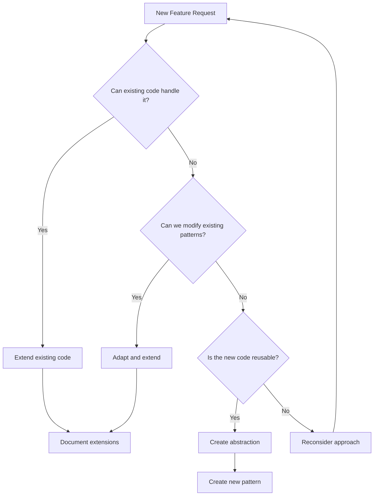

# Code Optimization Principles & Extended Thinking Framework

## Overview

This document establishes optimization principles based on successful patterns from our codebase. These principles leverage extended thinking methodologies to ensure thorough analysis before implementation.

## Core Philosophy

> "The best code is no code. The second best code is code that already exists and works."

### The LEVER Framework

**L**everage existing patterns  
**E**xtend before creating  
**V**erify through testing  
**E**liminate duplication  
**R**educe complexity  

## 🧠 Extended Thinking Process

Based on [Anthropic's Extended Thinking methodology](https://docs.anthropic.com/en/docs/build-with-claude/extended-thinking), always follow this decision tree:



## 📋 Pre-Implementation Checklist

Before writing any code, complete this extended thinking exercise:

### 1. Pattern Recognition Phase (10-15 minutes)
```markdown
## Existing Pattern Analysis
- [ ] What similar functionality already exists?
- [ ] Which Server Actions/API routes handle related data?
- [ ] What UI components display similar information?
- [ ] Which hooks manage related state?

## Code Reuse Opportunities
- [ ] Can I extend an existing table instead of creating a new one?
- [ ] Can I add fields to an existing DTO/interface?
- [ ] Can I enhance an existing hook with new computed properties?
- [ ] Can I modify an existing component with conditional rendering?
```

### 2. Complexity Assessment (5-10 minutes)
```markdown
## Proposed Solution Complexity
- Lines of new code: ___
- New files created: ___
- New database tables: ___
- New API endpoints: ___

## Optimized Alternative
- Lines extending existing code: ___
- Files modified: ___
- Fields added to existing tables: ___
- Existing endpoints enhanced: ___

If optimized < 50% of proposed, proceed with optimization.
```

## 🏗️ Architecture Principles

### 1. Database Schema Extensions

#### ❌ Anti-Pattern: Creating New Tables
```typescript
// DON'T: Create separate tracking table
const CampaignTracking = {
  userId: String,
  source: String,
  medium: String,
  // ... 10 more fields
}

// Requires joins, separate queries, sync logic
```

#### ✅ Pattern: Extend Existing Tables
```typescript
// DO: Add fields to users table
const User = {
  // ... existing fields ...
  
  // Campaign tracking (minimal additions)
  campaignSource: String, // optional
  inviteCodeUsed: String, // optional
}
// Data locality, no joins, existing indexes work
```

### 2. Data Fetching Optimization

#### ❌ Anti-Pattern: Duplicate Fetch Logic
```typescript
// DON'T: Create similar fetch functions
export async function getTrialUsers() { /* ... */ }
export async function getActiveTrials() { /* ... */ }
export async function getExpiringTrials() { /* ... */ }
```

#### ✅ Pattern: Extend Existing Fetchers
```typescript
// DO: Add to getUserStatus
export async function getUserStatus(userId: string) {
  // ... existing logic ...
  const user = await db.user.findUnique({ where: { id: userId } });
  
  return {
    // ... existing fields ...
    // Just add what's needed
    isTrialFromCampaign: Boolean(user?.campaignSource),
    trialDaysRemaining: calculateDaysRemaining(user),
  }
}
```

### 3. Frontend State Management

#### ❌ Anti-Pattern: New Hooks for Similar Data
```typescript
// DON'T: Create overlapping hooks
export function useTrialStatus() { /* ... */ }
export function useCampaignData() { /* ... */ }
export function useUserMetrics() { /* ... */ }
```

#### ✅ Pattern: Enhance Existing Hooks
```typescript
// DO: Extend useSubscription
export function useSubscription() {
  const { data: userStatus } = useQuery({ 
    queryKey: ['userStatus'], 
    queryFn: getUserStatus 
  })
  
  // Add computed properties for new features
  const enhancedData = useMemo(() => ({
    ...userStatus,
    // New campaign-aware properties
    shouldShowTrialOffer: userStatus?.isTrialing && userStatus?.daysRemaining <= 3,
    campaignEffectiveness: calculateCampaignROI(userStatus),
  }), [userStatus])
  
  return enhancedData
}
```

## 🔄 Next.js Specific Optimizations

### 1. Leverage Server Components

```typescript
// ❌ DON'T: Client-side fetching for static/initial data
'use client'
function UserProfile() {
  const [user, setUser] = useState(null)
  useEffect(() => {
    fetch('/api/user').then(...)
  }, [])
  // ...
}

// ✅ DO: Fetch in Server Component
// app/profile/page.tsx
async function UserProfile() {
  const user = await getUser(userId)
  return <ProfileView user={user} />
}
```

### 2. Server Actions for Mutations

```typescript
// ❌ DON'T: API Routes for simple mutations
// pages/api/update-user.ts
export default async function handler(req, res) {
  // ... boilerplate ...
}

// ✅ DO: Server Actions
// actions.ts
'use server'
export async function updateUser(formData: FormData) {
  // Direct DB access, type safety
  await db.user.update(...)
  revalidatePath('/profile')
}
```

### 3. Optimize Cache Usage

```typescript
// ❌ DON'T: Re-fetch same data in multiple components
// Component A
const user = await getUser(id)
// Component B
const user = await getUser(id)

// ✅ DO: Request Memoization
import { cache } from 'react'
export const getUser = cache(async (id) => {
  return db.user.findUnique(...)
})
// Called once per request
```

## 📊 Decision Framework

### When to Extend vs Create New

Use this scoring system:

| Criteria | Extend Existing | Create New |
|----------|----------------|------------|
| Similar data structure exists | +3 points | -3 points |
| Can reuse existing indexes | +2 points | -2 points |
| Existing queries return related data | +3 points | -3 points |
| UI components show similar info | +2 points | -2 points |
| Would require <50 lines to extend | +3 points | -3 points |
| Would introduce circular dependencies | -5 points | +5 points |
| Significantly different domain | -3 points | +3 points |

**Score > 5**: Extend existing code  
**Score < -5**: Create new implementation  
**Score -5 to 5**: Deeper analysis required  

## 🛠️ Implementation Strategies

### 1. The Three-Pass Approach

**Pass 1: Discovery (No Code)**
- Find all related existing code
- Document current patterns
- Identify extension points

**Pass 2: Design (Minimal Code)**
- Write interface changes only
- Update type definitions
- Plan data flow

**Pass 3: Implementation (Optimized Code)**
- Implement with maximum reuse
- Add only essential new logic
- Document why choices were made

### 2. Code Reuse Patterns

#### Pattern: Feature Flags in Existing Components
```typescript
// Instead of new component
export function SubscriptionStatus({ userStatus, campaignData }) {
  return (
    <>
      {/* Existing UI */}
      
      {/* Conditionally show new features */}
      {campaignData?.isTrialFromCampaign && (
        <CampaignBadge source={campaignData.source} />
      )}
    </>
  )
}
```

#### Pattern: Computed Properties
```typescript
// Instead of new queries
export async function getUserStatus(userId) {
  const user = await getUser(userId)
  
  // Compute new properties from existing data
  return {
    ...user,
    // Derived campaign metrics
    campaignConversionValue: user.subscriptionTier 
      ? prices[user.subscriptionTier] * 12 
      : 0,
    isHighValueTrial: user.subscriptionTier === 'creator' && user.isTrialing,
  }
}
```

## ⚡ Performance Optimization Rules

### 1. Query Efficiency
```typescript
// ❌ Multiple round trips
const user = await getUser(id)
const subscription = await getSubscription(id)
const usage = await getUsage(id)

// ✅ Single query returning all data (or parallel)
const userStatus = await getUserStatus(id)
// Returns user + subscription + usage in one call
```

### 2. Batch Operations
```typescript
// ❌ Sequential operations
for (const item of items) {
  await updateItem(item.id, updates)
}

// ✅ Batch when possible
await db.item.updateMany({
  where: { id: { in: items.map(i => i.id) } },
  data: updates
})
```

## 🚫 Anti-Patterns to Avoid

### 1. The "Just One More Table" Trap
Each new table adds:
- Schema complexity
- Join requirements  
- Sync challenges
- Migration overhead

**Ask**: Can this data live in an existing table?

### 2. The "Similar But Different" Excuse
Before creating `getUserTrialStatus` when `getUserStatus` exists:
- Can getUserStatus return trial fields?
- Can we add a `includeTrial` parameter?
- Can computed properties derive what we need?

### 3. The "UI Drives Database" Mistake
Never create database structure to match UI components. Instead:
- Store data in its most logical form
- Use queries to transform for UI
- Let components compute display values

## 🎯 Success Metrics

Track optimization success:

| Metric | Target |
|--------|--------|
| Code reduction vs initial approach | >50% |
| Reused existing patterns | >70% |
| New files created | <3 per feature |
| New database tables | 0 (extend existing) |
| Implementation time | <50% of estimate |

## 🔍 Review Checklist

Before submitting optimized code:

- [ ] Extended existing tables instead of creating new ones
- [ ] Reused existing queries with additions
- [ ] Leveraged existing hooks and components  
- [ ] No duplicate state management logic
- [ ] Documented why extensions were chosen
- [ ] Maintained backward compatibility
- [ ] Added fields are optional
- [ ] No circular dependencies introduced
- [ ] Performance same or better
- [ ] Code reduction >50%

---

*Remember: Every line of code is a liability. The best feature is one that requires no new code, just better use of what exists.*